# Hey, I'm Sejal Srivastava 👋

### Software Engineer | Mobile Engineering | Full-Stack Development | Open Source

I build mobile applications and explore the engineering systems behind them — from React Native and native Android integrations to backend APIs and data layers.

I'm a Software Engineer at **Appinventiv**, with 3+ years of experience building and shipping production mobile applications for Android and iOS.

I enjoy solving problems beyond UI development: performance optimization, native platform integrations, application architecture, real-time systems, and building reusable developer tools.

### 👩‍💻 What I Work On

- 📱 **Mobile Engineering:** React Native, TypeScript, Android native integrations, Kotlin
- ⚙️ **React Native Internals:** JSI, TurboModules, Fabric, Codegen, Hermes
- 🏗️ **Application Architecture:** MVVM, Atomic Design, modular architecture
- 🔌 **API & Data Layer:** GraphQL, Apollo Client, REST APIs, WebSockets
- 🚀 **Backend Engineering:** Node.js, Express.js, PostgreSQL, Prisma
- ⚡ **Performance & Storage:** MMKV, caching, optimization, efficient state management
- 🎥 **Media Engineering:** JW Player, React Native Video, Picture-in-Picture

### 🚀 Featured Work

**React Native Network Resilience**

An open-source React Native package focused on improving network request reliability through retry policies, request deduplication, connectivity handling, and persistent request queuing.

- [GitHub Repository](https://github.com/Sejal99/react-native-network-resilience)
- [View on npm](https://www.npmjs.com/package/react-native-network-resilience)

**Calmora**

A mobile wellness application exploring mood tracking, personalized experiences, local persistence, cloud synchronization, and interactive features.

- [Explore Repository](https://github.com/Sejal99/Calmora)

### 🌱 Currently Exploring

- Building scalable backend systems with Node.js and PostgreSQL
- Database design, Prisma ORM, and transaction management
- React Native New Architecture and native platform internals
- Meaningful open-source contributions
- System design and software architecture

### 🤝 Open Source & Community

I believe in learning by building and contributing.

I'm interested in:
- Contributing to impactful open-source projects
- Collaborating with developers across the world
- Participating in hackathons and developer programmes
- Sharing engineering knowledge through technical writing

### 🛠️ Technologies & Tools

**Languages**

JavaScript · TypeScript · Kotlin · SQL

**Mobile & Frontend**

React Native · React · Next.js · Android

**Backend & APIs**

Node.js · Express.js · REST · GraphQL · Apollo Client · WebSockets

**Databases & Storage**

PostgreSQL · Prisma · MongoDB · Firebase · MMKV

**State Management & Architecture**

Zustand · Redux · MVVM · Atomic Design

**Tools & Platforms**

Git · GitHub · Docker · Postman · Android Studio · Xcode

### ✍️ Technical Writing

I enjoy documenting engineering concepts and sharing what I learn.

- [Read my articles on Medium](https://medium.com/@SejalSrivastava)

### 📊 GitHub Statistics

  

  

### 📫 Let's Connect

  
  
  

📧 **Email:** [sejal8974@gmail.com](mailto:sejal8974@gmail.com)

---

*Building, learning, contributing — one commit at a time.*
